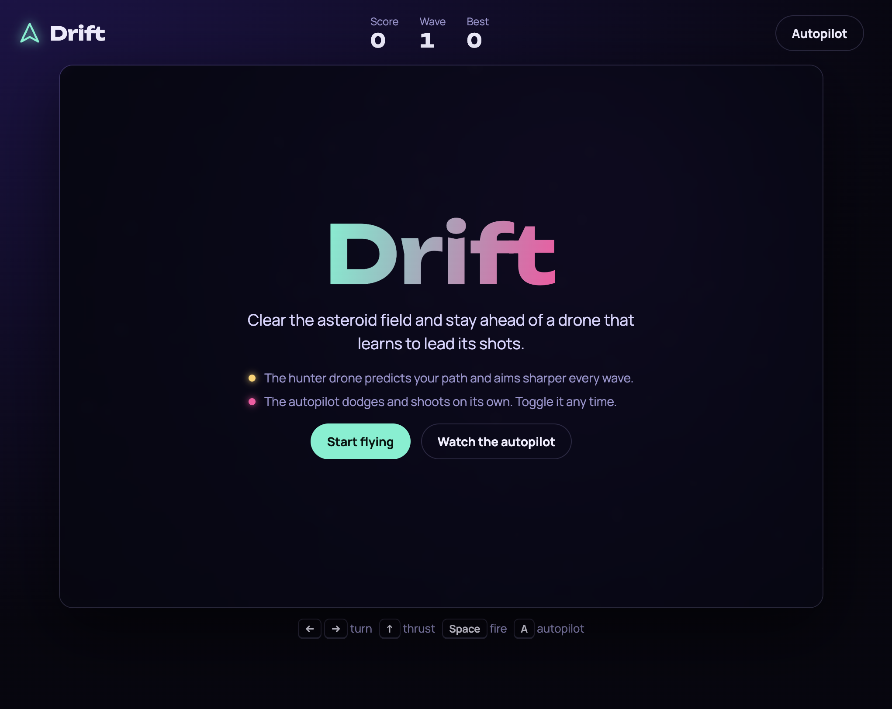

<div align="center">

# Drift

**Asteroids, reimagined with two AI systems: an autopilot that flies for you and a hunter drone that learns to lead its shots.**

[](https://valentina14142000.github.io/drift-asteroids/)
[](https://github.com/Valentina14142000/drift-asteroids/actions)
[](LICENSE)



</div>

## Play it

**https://valentina14142000.github.io/drift-asteroids/**

Works on desktop and mobile. No install, no build step, no dependencies.

## Features

- **Autopilot** that dodges and shoots on its own. Toggle it at any moment, or start a run just to watch it.
- **Hunter drone** that predicts where you will be and fires there. Its aim sharpens and its fire rate climbs every wave.
- **Glowing vector look** with parallax stars, a nebula backdrop, particle explosions and screen shake.
- **Wave-based progression.** Rocks split into smaller, faster pieces, and each wave adds more of them.
- **Persistent best score** stored in your browser.
- **Touch controls** that appear automatically on phones and tablets.
- **Zero dependencies.** Plain HTML, CSS and JavaScript on a single canvas.

## Controls

| Action | Keyboard | Touch |
| --- | --- | --- |
| Turn | `←` `→` or `A`/`D` style arrows | Left / Right |
| Thrust | `↑` or `W` | Thrust |
| Fire | `Space` | Fire |
| Toggle autopilot | `A` | Autopilot button |
| Start / restart | `Space` or `Enter` | Start button |

## How the AI works

Neither system uses a model or a network call. Both are small, readable algorithms in [`game.js`](game.js).

### Autopilot

Each frame the autopilot does three things:

1. **Threat prediction.** For every asteroid it computes the time of closest approach from relative position and velocity, wrapping across screen edges. Any rock that will pass inside a safety margin within the next 3 seconds counts as a threat.
2. **Evasion.** If the worst threat arrives in under 1.6 seconds, the ship turns directly away from it and thrusts.
3. **Lead aiming.** Otherwise it targets the nearest rock (or the drone) and solves the intercept equation for a bullet of known speed, so shots land where the target will be, not where it is. It fires once aligned within a small angle and in range.

### Hunter drone

The drone steers toward your predicted position, keeping its distance, and uses the same intercept maths as the autopilot to aim. A random aiming error is added that shrinks as the wave number rises, so early drones are easy to dodge and later ones are not.

| Property | Value |
| --- | --- |
| Hits to destroy | 2 |
| Score | 300 |
| Bullet speed | 300 px/s |
| Fire interval | 2.4 s, down to 0.9 s as waves rise |

### Scoring

| Target | Points |
| --- | --- |
| Large asteroid | 20 |
| Medium asteroid | 50 |
| Small asteroid | 100 |
| Hunter drone | 300 |

## Run locally

```bash
git clone https://github.com/Valentina14142000/drift-asteroids.git
cd drift-asteroids
npx serve .
```

Open the URL it prints. Opening `index.html` directly also works.

## Project structure

```
drift-asteroids/
├── index.html                  Page shell, HUD and menu overlays
├── style.css                   Layout, typography and theme
├── game.js                     Game loop, physics, rendering and AI
├── docs/screenshot.png         README screenshot
└── .github/workflows/pages.yml Automatic GitHub Pages deployment
```

## Deployment

Every push to `main` is deployed to GitHub Pages by the workflow in [`.github/workflows/pages.yml`](.github/workflows/pages.yml). To enable it on a fork, open **Settings → Pages** and set **Source** to **GitHub Actions**.

## Roadmap

- [ ] Sound effects and music
- [ ] Power-ups: shield, spread shot, slow time
- [ ] Difficulty levels and a daily seeded run
- [ ] Online leaderboard
- [ ] Let a language model narrate the run

## License

Released under the [MIT License](LICENSE).
